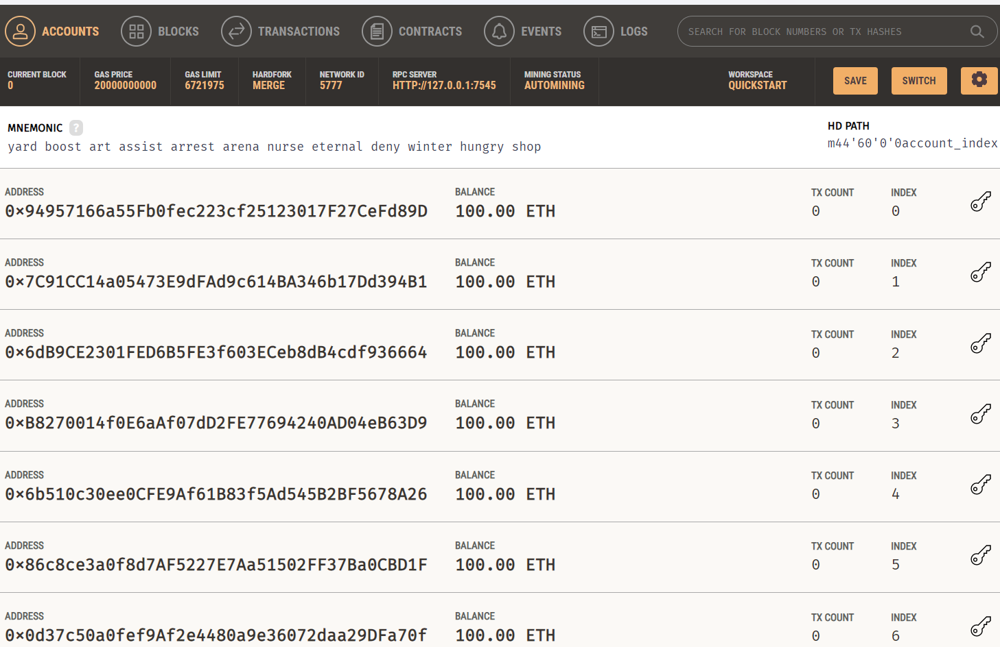
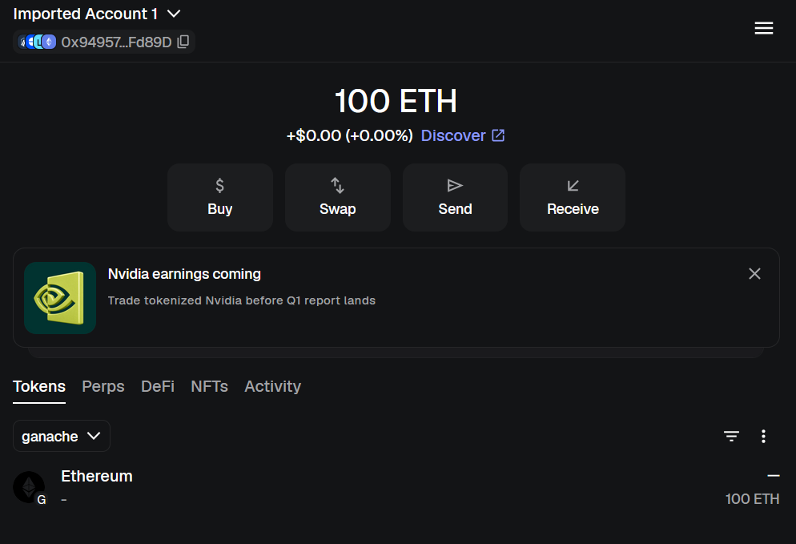
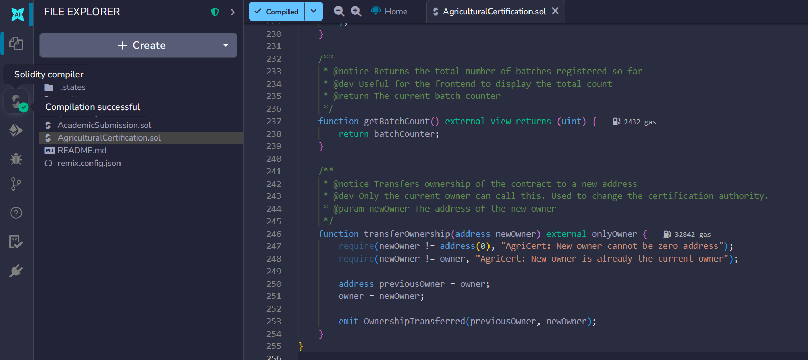
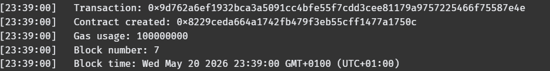
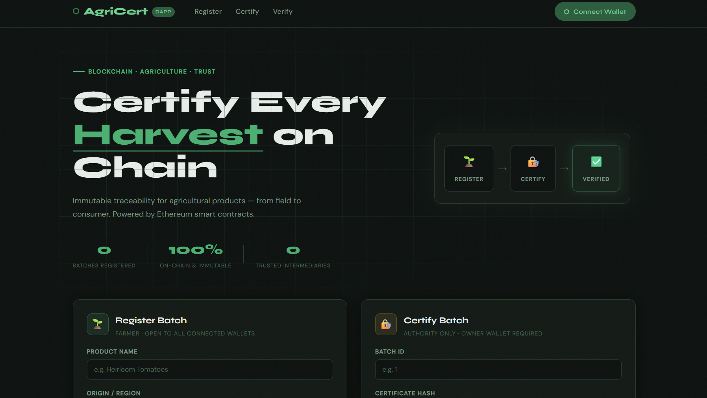
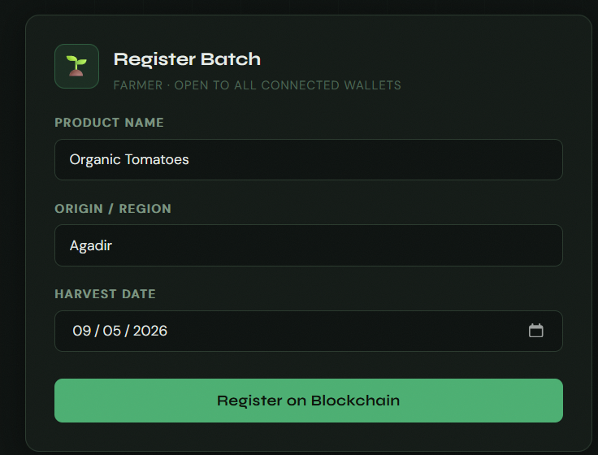
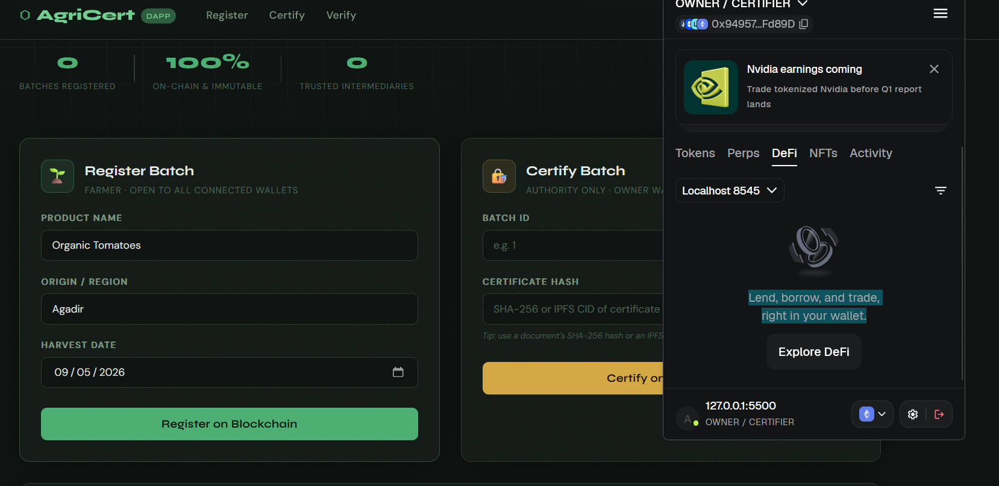
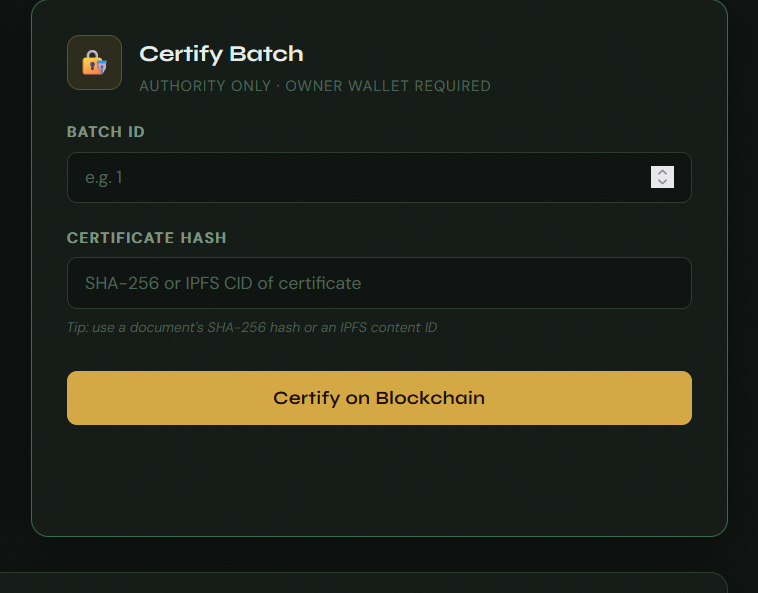
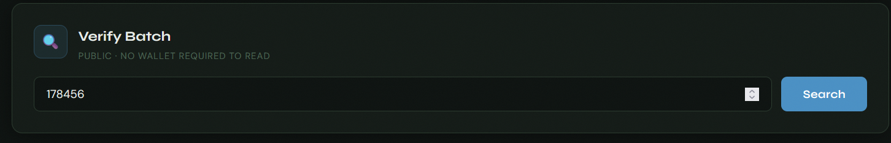

# 🌱 AgriCert DApp
### Agricultural Product Certification on the Blockchain

> **Mini University Project** · Blockchain · Agriculture · Agri-Food
> Academic Year 2024–2025

---

## 1. 📌 Project Title

**AgriCert** — Decentralized Application for Agricultural Product Certification

---

## 2. 🌾 Chosen Sector

**Agriculture / Agri-Food**

This sector suffers from a lack of transparency in the supply chain: consumers cannot verify the real origin of a product, and paper certificates are easily falsifiable. AgriCert addresses this problem by using the blockchain as a public, immutable, and verifiable registry.

---

## 3. 🎯 DApp Objective

AgriCert enables:

- **Registering** agricultural product batches on the blockchain (by the farmer)
- **Certifying** those batches by a recognized certification authority
- **Publicly verifying** the authenticity and traceability of any batch, without an intermediary

The ultimate goal is to **replace falsifiable paper certificates** with immutable blockchain records, accessible to everyone and instantly verifiable.

---

## 4. ❓ Use Case Analysis — Step 2

### 4.1 What problem are we solving?

In the agricultural sector, product certification still relies heavily on paper documents or centralized databases, which causes several problems:

- **Easy falsification** of certificates of origin and quality
- **Lack of transparency** between producers, distributors, and consumers
- **Absence of reliable traceability** from field to table
- **Dependency on trusted third parties** (centralized organizations) — costly and slow
- **Origin fraud**: foreign products sold as local or organic

AgriCert solves these problems by recording each certification directly on the Ethereum blockchain, making data **public, immutable, and verifiable without a third party**.

---

### 4.2 Who are the actors?

| Actor | Role | Rights in the System |
|---|---|---|
| 🧑‍🌾 **Farmer** | Producer of the agricultural batch | Registers a new batch (name, origin, harvest date) |
| 🏛️ **Certification Authority** | Certifying body (contract owner) | Certifies a batch by attaching an official certificate hash |
| 🌍 **Public User** | Consumer, distributor, inspector | Consults and verifies batch information by its ID |

> The certification authority is the **account that deployed the smart contract** (the `owner`). It is the only one that can validate a certification.

---

### 4.3 What data will be stored ON-CHAIN?

On-chain data is **permanent, public, and immutable** once written to the blockchain.

| Field | Solidity Type | Justification |
|---|---|---|
| `id` | `uint` | Auto-incremented unique batch identifier |
| `productName` | `string` | Name of the agricultural product (e.g. "Tomatoes") |
| `origin` | `string` | Region/country of origin declared by the farmer |
| `harvestDate` | `string` | Harvest date declared by the farmer |
| `certified` | `bool` | Certification status (true/false) |
| `certificateHash` | `string` | Cryptographic fingerprint of the certification document |
| `farmer` | `address` | Ethereum address of the farmer (proof of identity) |
| `certifier` | `address` | Ethereum address of the certifying authority |
| `createdAt` | `uint` | Blockchain timestamp of the registration |

> These fields are stored in a `mapping(uint => Batch)` inside the smart contract.

---

### 4.4 What data will remain OFF-CHAIN?

Off-chain data is **too large or sensitive** to store directly on the blockchain (high gas cost, privacy, etc.).

| Data | Suggested Storage | Reason |
|---|---|---|
| **PDF certificate document** | IPFS / Authority server | Large file, not suitable for the blockchain |
| **Product/field photos** | IPFS / Cloud | Binary media, too heavy for on-chain storage |
| **Farmer personal data** | Private database | GDPR compliance / privacy protection |
| **Detailed inspection reports** | Authority internal system | Confidential internal documents |
| **Logistics data** (transport, temperature) | IoT database | Real-time data, too high volume |
| **Phone numbers / emails** | Private database | Sensitive personal data |

> The link between on-chain and off-chain is made via the **`certificateHash`**: it is the SHA-256 hash (or IPFS CID) of the document stored off-chain. Anyone with the document can verify that it matches the hash recorded on the blockchain.

---

### 4.5 Why use the Blockchain?

| Blockchain Concept | Concrete Application in AgriCert |
|---|---|
| **Immutability** | Once a batch is registered, its data can no longer be modified or deleted |
| **Transparency** | Anyone can consult batch information without permission |
| **Traceability** | The farmer's address and timestamp prove the origin and moment of registration |
| **Decentralization** | No central entity controls the data — it belongs to the blockchain |
| **Trustless** | A consumer can verify a certification without contacting the certifying body |
| **Cryptographic Proof** | The `certificateHash` links the physical document to the blockchain record in a verifiable way |
| **Access Control** | Only the contract owner (authority) can certify — guaranteed by code, not by trust |

The blockchain is justified here because **several parties who do not trust each other** (farmers, authorities, consumers) need a **common and neutral registry**. A centralized system could be manipulated by one of the parties.

---

### 4.6 What are the limitations of the solution?

| Limitation | Explanation |
|---|---|
| **Local blockchain only** | The project uses Ganache (local network). Deployment on a public network (Sepolia, Polygon) would be required for real use |
| **Unverified identity** | Anyone can register as a "farmer" — there is no real identity verification (KYC) |
| **Single authority** | Only one account can certify. If the owner's private key is lost, the system is blocked |
| **Off-chain data not guaranteed** | The hash guarantees document integrity, but if the PDF is deleted from the server, the hash alone becomes useless |
| **Gas cost** | On a public network, each registration and certification incurs transaction fees (gas) paid in ETH |
| **No updates possible** | The blockchain is immutable: an error in a record (typo, wrong date) cannot be corrected |
| **Scalability** | Ethereum mainnet is limited in transaction throughput (~15 tx/s), which may be a problem at scale |
| **English-only interface** | The frontend is in English — localization would be needed for local farmers |

---

## 5. ⚙️ Smart Contract Functions

### Contract: `AgriculturalCertification.sol` (Solidity `^0.8.20`)

#### Main Struct

```solidity
struct Batch {
    uint id;
    string productName;
    string origin;
    string harvestDate;
    string certificateHash;
    bool certified;
    address farmer;
    address certifier;
    uint createdAt;
}
```

#### Functions

| Function | Access | Description |
|---|---|---|
| `registerBatch(productName, origin, harvestDate)` | Any connected user | Creates a new batch with a unique ID and timestamps it |
| `certifyBatch(id, certificateHash)` | Owner only (`onlyOwner`) | Marks a batch as certified and records the certificate hash |
| `getBatch(id)` | Public (free read) | Returns all information for a batch by its ID |
| `getBatchCount()` | Public (free read) | Returns the total number of registered batches |
| `transferOwnership(newOwner)` | Owner only | Transfers certification rights to a new address |

#### Modifiers

| Modifier | Role |
|---|---|
| `onlyOwner` | Restricts access to sensitive functions to the contract owner only |
| `batchExists(id)` | Verifies that a batch with this ID exists before executing a function |

#### Emitted Events

| Event | Parameters | Trigger |
|---|---|---|
| `BatchRegistered` | `id`, `productName`, `farmer` | On each newly registered batch |
| `BatchCertified` | `id`, `certificateHash`, `certifier` | On each certified batch |
| `OwnershipTransferred` | `previousOwner`, `newOwner` | On deployment and on each ownership transfer |

---

## 6. 🛠️ Tools Used

| Layer | Tool | Version / Notes |
|---|---|---|
| Smart Contract | **Solidity** | `^0.8.20` |
| IDE & Deployment | **Remix IDE** | [remix.ethereum.org](https://remix.ethereum.org) |
| Local Blockchain | **Ganache** | Local network `http://127.0.0.1:7545` |
| Wallet | **MetaMask** | Chrome/Firefox browser extension |
| Frontend Interface | **HTML5 + CSS3 + JavaScript** | Vanilla JS, no framework |
| Blockchain Library | **Ethers.js v6** | Loaded via CDN |
| Dev Server | **VS Code Live Server** | VS Code extension |

---

## 7. 📁 Project Architecture

```
AgriCert/
├── contracts/
│   └── AgriculturalCertification.sol   # Solidity smart contract (business logic)
├── frontend/
│   ├── index.html                       # Main user interface
│   ├── style.css                        # Styles (green agriculture theme, dark mode)
│   └── app.js                           # MetaMask connection + contract calls (Ethers.js v6)
└── README.md                            # Full project documentation
```

---

## 8. 🚀 Execution Steps

### Prerequisites

- [Ganache](https://trufflesuite.com/ganache/) installed
- [MetaMask](https://metamask.io/) installed in the browser
- [VS Code](https://code.visualstudio.com/) + **Live Server** extension
- Chrome or Firefox browser

---

### Step 1 — Launch Ganache

1. Open Ganache and click **"Quickstart Ethereum"**
2. Note the RPC URL: `HTTP://127.0.0.1:7545` and Network ID: `1337`
3. Keep Ganache open

---

### Step 2 — Configure MetaMask

1. Open MetaMask → networks menu → **"Add a network manually"**
2. Fill in:
   - Name: `Ganache Local`
   - RPC: `http://127.0.0.1:7545`
   - Chain ID: `1337`
   - Symbol: `ETH`
3. Import two Ganache accounts (🔑 icon) into MetaMask:
   - **Account 1** = Owner / Certification Authority
   - **Account 2** = Farmer

---

### Step 3 — Deploy the Contract with Remix

1. Go to [https://remix.ethereum.org](https://remix.ethereum.org)
2. Create the file `AgriculturalCertification.sol` and paste the contract code
3. **Compiler** tab → version `0.8.20` → **Compile**
4. **Deploy & Run** tab → Environment: **"Injected Provider - MetaMask"**
5. Select `AgriculturalCertification` → **Deploy** → Confirm in MetaMask
6. Copy the deployed **contract address**
7. Copy the **ABI** from the Compiler tab

---

### Step 4 — Configure the Frontend

Open `frontend/app.js` and replace:

```javascript
const CONTRACT_ADDRESS = "0xYourAddressHere";   // ← address copied from Remix
const CONTRACT_ABI = [ /* ... paste the ABI here ... */ ];
```

---

### Step 5 — Launch the Interface

1. Open the `frontend/` folder in VS Code
2. Right-click on `index.html` → **"Open with Live Server"**
3. The browser opens `http://127.0.0.1:5500/frontend/index.html`
4. Click **"Connect Wallet"** → accept in MetaMask

---

### Complete Usage Flow

```
[Farmer]    →  Fills the form      →  registerBatch()  →  Tx confirmed ✓
[Authority] →  Enters ID + hash    →  certifyBatch()   →  Tx confirmed ✓
[Public]    →  Enters the ID       →  getBatch()       →  Result displayed ✓
```

---

## 9. 📸 Main Screenshots

> Replace these placeholders with real screenshots after running the project.

| # | File | Description |
|---|---|---|
| 1 |  | Ganache launched with test accounts and ETH balances |
| 2 |   | MetaMask connected to the Ganache Local network |
| 3 |  | Contract compiled without errors in Remix |
| 4 |  | Deployment confirmation in MetaMask |
| 5 |  | AgriCert home page with connected wallet |
| 6 |  | Batch registration form filled in |
| 7 |   | MetaMask transaction confirmation pop-up |
| 8 |  | Verification result showing the ✓ Certified badge |
| 9 |  | Verification result showing the ⏳ Pending badge |

---

## 10. ⚠️ Project Limitations

1. **Local blockchain only** — Ganache is a local test network. For real use, deployment on a public network (Sepolia, Polygon) would be necessary.
2. **Unverified identity (no KYC)** — Any wallet can register as a farmer. There is no real identity verification.
3. **Single certification authority** — Only one account (`owner`) can certify batches. Loss of the private key would block the system.
4. **Off-chain data not guaranteed** — The hash guarantees document integrity, but if the PDF is deleted from the server, the hash alone becomes useless.
5. **Data is non-modifiable** — In case of an input error (wrong date, typo), it is impossible to correct a record — the blockchain is immutable.
6. **Gas cost** — On a public network, each transaction (registration, certification) incurs fees paid in ETH.
7. **No batch listing** — The interface does not allow listing all batches. The user must know the ID of the batch to search for.
8. **English-only interface** — The interface is not localized in French or Arabic for local farmers.

---

## 11. 🚀 Possible Improvements

| Priority | Improvement | Description |
|---|---|---|
| 🔴 High | **Public network deployment** | Deploy on Sepolia or Polygon Mumbai for a real environment |
| 🔴 High | **IPFS integration** | Store certificate PDFs on IPFS, record the CID on-chain to guarantee availability |
| 🟡 Medium | **Multi-certifier system** | Allow multiple accredited authorities to certify (via OpenZeppelin `AccessControl`) |
| 🟡 Medium | **Batch listing & pagination** | Display all registered batches in a paginated table |
| 🟡 Medium | **QR Code generation** | Generate a QR code per batch pointing to its public verification page |
| 🟢 Low | **Identity verification (KYC)** | Link Ethereum addresses to verified identities (registered farmers) |
| 🟢 Low | **Mobile application** | React Native frontend for field use by farmers |
| 🟢 Low | **Step-by-step updates** | Allow adding checkpoints (transport, storage, sale) to each batch |
| 🟢 Low | **Localization** | Translate the interface into French and Arabic |

---

## 👨‍💻 Authors
EL ANSARI AL MAHDI
> Mini University Project — Blockchain in Agriculture
> Academic Year 2025–2026

---

## 📜 License

This project is for educational purposes only.
MIT License — free to use, modify, and distribute.